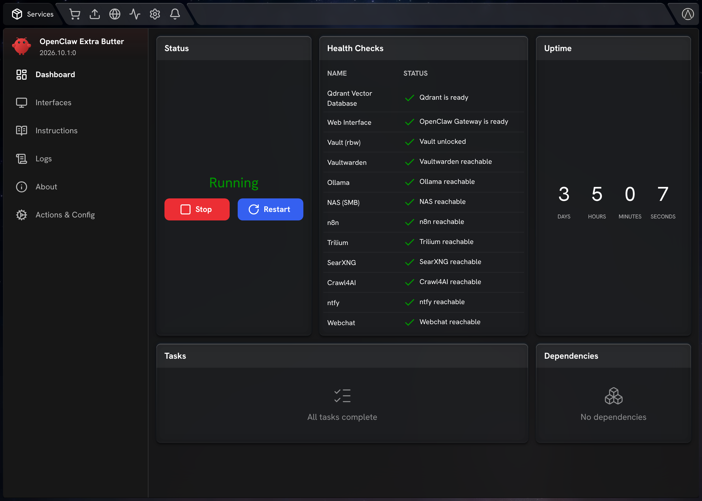

<p align="center">
  
</p>

# OpenClaw Extra Butter (OpenClaw on StartOS)

> Everything not listed in this document should behave the same as upstream
> OpenClaw. If a feature, setting, or behavior is not mentioned here, the
> upstream documentation is accurate and fully applicable — see the
> Documentation section of `instructions.md` for links.

[OpenClaw](https://github.com/openclaw/openclaw) is a self-hosted AI agent gateway: a web chat and control panel in front of an LLM, reachable from messaging channels, with a workspace and memory of its own. This package runs the gateway, wires it to either a cloud provider or a local model server on the same box, and can — if you ask it to — give the agent administrative control of StartOS itself.

**This is a fork of the community package** ([Start9-Community/openclaw-startos](https://github.com/Start9-Community/openclaw-startos)) with its own package id, `openclaw-extrabutter`, shown in StartOS as **OpenClaw Extra Butter**. It installs alongside the community OpenClaw package and never replaces it; each has its own volumes, Qdrant and addresses. Don't connect both to the same Telegram bot or WhatsApp number. On top of the community package it adds:

- a bundled **Qdrant** vector database (its own volume) and a skill for it;
- **helper agents** the main agent can spawn, managed from an action (Configure Agents) or by the agent itself;
- a built-in **rbw** vault client (rbw 1.15.0, Bitwarden-compatible, installed for x86_64 and aarch64): point it at your Vaultwarden once and the package logs in and unlocks the vault at every start, keeps it unlocked, and lets the other services fetch their credentials from it instead of storing them in plain config;
- **Configure External Services**: optional skills for services you already run (Vaultwarden, Ollama, an SMB NAS, n8n, Trilium, SearXNG, Crawl4AI, ntfy and Gitea), plus host mappings and a custom CA for internal HTTPS services;
- **email** (Configure Email): Gmail with an app password or any IMAP provider, through an isolated **mail service** and an **email agent** that has the mail tools and nothing else (the main agent never reads mail); or a Google account with Gmail, Calendar and Drive (gog 0.44.0, not yet isolated); every credential can live in Vaultwarden;
- a **mobile webchat** with one profile per person (optional);
- a built-in **pdf** skill (text extraction and OCR of scanned pages) and a **health** skill;
- **memory embeddings** settings and a daily server snapshot in the agent's memory.

- **Upstream repo:** <https://github.com/openclaw/openclaw>
- **This package:** <https://github.com/usuallymark/openclaw-extrabutter-startos> (releases carry the `.s9pk` files for sideloading: StartOS → System → Sideload a Service)

## Screenshots

The service dashboard, with a health check for every external service you enable:



More: [Actions & Config](docs/screenshots/actions.png), Configure External Services ([part 1](docs/screenshots/external-services-1.png), [part 2](docs/screenshots/external-services-2.png)), or all of it as a [three-page PDF tour](docs/OpenClaw-Extra-Butter-tour.pdf). The screenshots are StartOS's own interface showing this package's real actions and forms, filled in with example values.

---

## Table of Contents

- [Image and Container Runtime](#image-and-container-runtime)
- [Volume and Data Layout](#volume-and-data-layout)
- [File Models](#file-models)
- [Dependencies](#dependencies)
- [Network Access and Interfaces](#network-access-and-interfaces)
- [Installation and First-Run Flow](#installation-and-first-run-flow)
- [Actions](#actions)
- [Tasks](#tasks)
- [Health Checks](#health-checks)
- [Backups and Restore](#backups-and-restore)
- [Limitations and Differences](#limitations-and-differences)
- [Quick Reference for AI Consumers](#quick-reference-for-ai-consumers)

---

## Image and Container Runtime

One image, built here.

| Property      | Value                               |
| ------------- | ----------------------------------- |
| Image         | Built from this repo's `Dockerfile` |
| Architectures | x86_64, aarch64                     |
| Command       | The gateway, bound to the LAN       |

| Subcontainer   | Purpose                                                            |
| -------------- | ------------------------------------------------------------------ |
| `openclaw-sub` | The gateway, the webchat and the oneshots — the one to `attach` to |
| `qdrant-sub`   | Qdrant, from the official image                                    |

**The image also installs `start-cli`**, pinned to a version by a build argument. That binary is what lets the agent administer the server when you grant it access, and it is why the container needs StartOS's root certificate. It also carries the skills (`/opt/skills`), the GitHub CLI, `rbw`, Python libraries for the skills (`/opt/python-libs`, hash-pinned in `skills/requirements.txt`) and Tesseract for OCR.

Daemons: `qdrant`, `primary` (the gateway), `webchat` while it is enabled, `mail-front` + `mail` (the mail service, below) while Configure Email uses Gmail or IMAP, and `calendar-front` + `calendar` (the calendar service) while Configure Calendar is on. Every health check runs through `startos/stopLog.ts`, which logs `[stop]` lines in the package log when a stop begins: which checks are mid-run, every 15 s which are still running, and when each finishes (for updates that stall at 80% with the old version never stopping). It also limits every run: one that has not answered in 120 s, or 20 s after a stop began, counts as a failure and is let go (`[stop-log] check … let go`), because the SDK's `exec` waits for the subcontainer before its own timeout starts and that wait has no limit; on the box `ext-gitea` and `ext-ollama` hung there for 6 hours and held up an update.

Seven oneshots run before the gateway, and three after it:

| Oneshot                 | When   | Purpose                                                                                            |
| ----------------------- | ------ | -------------------------------------------------------------------------------------------------- |
| `install-root-ca`       | Before | Installs StartOS's root CA so the container trusts the OS                                          |
| `chown`                 | Before | Hands `/data` to the unprivileged user the gateway runs as, except `/data/.openclaw-mail` and `/data/.openclaw-calendar` |
| `network-setup`         | Before | Writes custom host mappings to `/etc/hosts` and installs a custom CA (Configure External Services) |
| `state-migrate`         | Before | Once per OpenClaw version: `openclaw doctor --non-interactive` to migrate the agent databases      |
| `setup-vault`           | Before | Logs `rbw` in to Vaultwarden, unlocks and syncs it; signs in again if Vaultwarden refuses the sync |
| `google-sign-in`        | Before | Google account kept in Vaultwarden: loads the OAuth client and sign-in token into gog              |
| `git-setup`             | Before | Writes git's system config: sign-in to Gitea and its address mapping (Configure External Services) |
| `check-login`           | After  | Raises a task if `start-cli` is not authenticated                                                  |
| `check-simplex-plugin`  | After  | Brings the SimpleX plugin up to the pinned version                                                 |
| `server-state-snapshot` | After  | Writes a server inventory (or, when not logged in, a health report) into `MEMORY.md`               |

**The first start after an OpenClaw update takes 1–2 minutes longer**, once: newer OpenClaw releases refuse to open agent databases written by older ones until `doctor` has migrated them with the gateway stopped. A marker (`/data/.startos/openclaw-doctor-version`) is written only on success; a failure is logged and retried at the next start and never blocks it.

**The gateway starts unconfigured on purpose.** It is launched with the flag that allows that, so the interface comes up and shows you what is missing rather than refusing to start.

## Volume and Data Layout

Two volumes.

| Volume   | Mount Point       | Purpose                     |
| -------- | ----------------- | --------------------------- |
| `main`   | `/data`           | The agent's entire home     |
| `qdrant` | `/qdrant/storage` | Qdrant's vector collections |

| Path                               | Written by  | Holds                                                    |
| ---------------------------------- | ----------- | -------------------------------------------------------- |
| `.openclaw/openclaw.json`          | Actions     | The gateway and agent configuration                      |
| `.openclaw/workspace/`             | Both        | The agent's identity, memory, and files                  |
| `.openclaw/agents/<id>/`           | OpenClaw    | Per-agent state database (sessions, auth, memory index)  |
| `.openclaw/external-services.json` | An action   | Configure External Services settings                     |
| `.openclaw-mail/settings.json`     | An action   | Configure Email settings; root only (0600)               |
| `.openclaw-mail/rules.json`        | An action   | Sending rules (from Configure Email); the service reads them |
| `.openclaw-mail/decisions/`        | An action   | Review Agent Actions decisions (root writes, service reads) |
| `.openclaw-mail/state/`            | Mail service| Activity log (no bodies), refused-password fingerprint, approval queue, send counts |
| `.openclaw/workspace/mail-inbox/`  | Mail service| Attachments released from trusted, verified senders      |
| `.openclaw/workspace/mail-outbox/` | Main agent  | Files to attach to outgoing drafts (service reads them)  |
| `.openclaw/workspace/workspaces/email/` | Package | The email agent's `AGENTS.md` (rewritten), `SOUL.md`, `IDENTITY.md` |
| `.openclaw-calendar/settings.json` | An action   | Configure Calendar settings, including a pasted Google sign-in; root only (0600) |
| `.openclaw-calendar/state/`        | Calendar service | Activity log (no event text), refused-sign-in fingerprint, own calendar id, approval queue, write counts |
| `.openclaw-calendar/decisions/`    | An action   | Review Agent Actions decisions for calendar requests (root writes, service reads) |
| `.openclaw/workspace/workspaces/calendar/` | Package | The calendar agent's `AGENTS.md` (rewritten), `SOUL.md`, `IDENTITY.md` |
| `.openclaw/rbw/`                   | The package | `rbw` config, cache and the saved master password (0600) |
| `.openclaw/webchat/`               | Both        | Webchat profiles, its state and file hand-offs           |
| `.startos/auth-profiles.json`      | An action   | Provider API keys                                        |
| `.startos/embeddings.json`         | An action   | Memory-embeddings provider choice                        |
| `.startos/config.yaml`             | The package | Where `start-cli` points                                 |
| `.startos/openclaw-doctor-version` | The package | Last OpenClaw version `state-migrate` ran for            |
| `simplex.json`                     | An action   | Whether SimpleX file exchange is on                      |

**`SOUL.md`, `IDENTITY.md` and `MEMORY.md` are seeded once** from the image when missing, and then belong to you: updates never replace them (they may live in your own git repository).

**Every start rewrites one section of `MEMORY.md`** (`## Server State Snapshot`) with `refresh-snapshot`: when `start-cli` is logged in, the server's metrics, packages, notifications, gateways, disks and backup targets; otherwise the health report. It is how the agent knows what it is running on — and it means the memory file can contain an inventory of your server. **A daily heartbeat runs the same command.** Its instructions are the heartbeat prompt in the configuration (`agents.defaults.heartbeat`), rewritten by init on every install and update and delivered nowhere (`target: none`).

## File Models

Eight models, each owning a different boundary.

| File                     | Format | Written by                         |
| ------------------------ | ------ | ---------------------------------- |
| `openclaw.json`          | JSON   | Actions, init, and OpenClaw itself |
| `auth-profiles.json`     | JSON   | Configure AI Provider              |
| `embeddings.json`        | JSON   | Configure AI Provider              |
| `external-services.json` | JSON   | Configure External Services        |
| `.openclaw-mail/settings.json` | JSON | Configure Email; init (moves the old `email` section here) |
| `webchat/config.json`    | JSON   | Configure Webchat                  |
| `config.yaml`            | YAML   | `main` and init                    |
| `simplex.json`           | JSON   | Configure SimpleX                  |

**The main configuration is shared with the application, not owned by the package.** OpenClaw edits it too — changing the model from inside the chat writes to the same file — which is why the dependency declaration reads it reactively rather than trusting the action to be the only writer.

Two gateway settings are **pinned** with `z.literal(true)`: the control UI being enabled, and the host-header origin fallback. The reason is structural: **StartOS fronts the gateway with its own reverse proxy on addresses that OpenClaw's origin check rejects.** With the fallback off, the interface simply refuses to connect. `main` also writes `gateway.trustedProxies` every start, set to the bridge address the proxy connects from — without it OpenClaw answers every proxied request with `403 proxy_attribution_required`. What remains in front of the gateway is its password and a one-time approval per browser — see [Network Access and Interfaces](#network-access-and-interfaces).

**API keys are stored in one place and consumed in another.** The action writes them into the auth-profiles file; OpenClaw reads them from the environment. `main` bridges the two at start, so a key added by the action reaches the gateway on the restart that follows. Since 2026.10.1:10 the bridge is a file, not the start command: `main` writes the keys and the other service secrets to `/data/.startos/gateway-secrets.env` (0600) and the gateway's command is `sh -c '. that file; exec "$@"' openclaw gateway …` (`startos/secretEnv.ts`), because StartOS passes a daemon's environment as command-line arguments, which every process in the server can read. The `google-sign-in` oneshot starts the same way; gog's keyring password and Login to StartOS's password go in on standard input. The file is the package's, which is why it lives under `.startos/` and not in OpenClaw's agent directory: a file of that name there is a retired credential source that OpenClaw's doctor archives and that makes the gateway refuse an agent whose own credential store is empty.

The `start-cli` configuration is rewritten at every start with the server's current address, so the agent's administrative tooling follows the box rather than a value recorded at install.

## Dependencies

All optional, and **each declared only while it is selected**. (Qdrant is bundled, not a dependency. External services set to *At an address* are reached by URL and are not dependencies; those set to *On this server* are.)

| Dependency               | Required             | Kind      | Why                           |
| ------------------------ | -------------------- | --------- | ----------------------------- |
| Ollama                   | No — only if chosen  | `running` | Local inference backend       |
| vLLM                     | No — only if chosen  | `running` | Local inference backend       |
| llama.cpp                | No — only if chosen  | `running` | Local inference backend       |
| SimpleX Websocket Bridge | No — only if enabled | `running` | Exchanging files over SimpleX |
| Vaultwarden, n8n, Trilium, SearXNG, Crawl4AI, ntfy, Gitea | No — only while *On this server* | `running` | Configure External Services (Ollama too, besides the AI backend) |

**The inference dependency follows the model you are actually using.** The declaration is derived from the primary model and its fallbacks, so selecting a local backend adds it and switching to a cloud provider drops it — including when the switch is made from inside the chat rather than through the action. Each is required to be running _and_ passing its own health check, since an unhealthy model server is the same as an absent one.

**A cloud provider needs no dependency at all**, only an API key and internet.

Local backends are reached over the internal bridge, and their API key is read directly out of the backend's own published volume rather than being asked for again.

SimpleX is different in kind: enabling it mounts the bridge's file-exchange directories into this container so the two can hand files to each other, and resolves the bridge's control socket over the bridge network.

## Network Access and Interfaces

Up to two interfaces.

| Interface | Id        | Type | Port  | Description                                       |
| --------- | --------- | ---- | ----- | ------------------------------------------------- |
| Web UI    | `ui`      | ui   | 18789 | The chat and the control panel                    |
| Webchat   | `webchat` | ui   | 18800 | Mobile webchat; exported only while it is enabled |

The Web UI is bound on the `ui-multi` MultiHost over HTTP and not masked. Qdrant (6333) is bound to the internal bridge only and never exported.

**The gateway password is the gate, and each browser is approved once.** OpenClaw's origin checking is relaxed for the reason given under [File Models](#file-models); its device pairing is not, and cannot be. A browser that passes the password is held at "Approve this browser" until the Approve Browser Pairing action admits it, and it then keeps a per-device credential until it is removed in the Web UI's device list. So anyone who can reach this address, knows the password, and can run that action has the agent — and, if StartOS access has been granted, the server. A `critical` task blocks the service from starting until that password is set, so there is no window where it is reachable without one.

Outbound, the gateway talks to whichever provider is configured, to any messaging channel you connect, to the external services you enable, and — for local backends and SimpleX — to the sibling service over the internal bridge.

**The webchat has its own gate**: anyone who can reach its address can open a profile that has no PIN. Give each profile a PIN if the address is reachable by others.

## Installation and First-Run Flow

Install creates the agent's directory structure, seeds its workspace from the image, points `start-cli` at the server, and pins the gateway settings. It then raises **two `critical` tasks**: set a gateway password, and configure an AI provider. Nothing in Configure External Services is required: with none of it set up, the agent still has the pdf, health, qdrant, agents and start-cli skills.

The first visit to the Web UI from any browser ends at "Approve this browser" after the password; running **Approve Browser Pairing** admits it and the page connects on its own.

**Neither can be skipped** — `critical` blocks startup, and an agent with no model and no password is not a usable state.

Once running, the gateway comes up on its interface and two more things happen automatically: it checks whether `start-cli` is authenticated and raises a task if not, and it writes the server snapshot into the agent's memory.

**Granting StartOS access is opt-in and deliberately not a critical task.** It is offered only after the gateway is up and only because the agent could not authenticate — see the action below before running it.

**Updating migrates OpenClaw's state** through the `state-migrate` oneshot (above), before the gateway starts. If vector memory search is paused afterwards, it also rebuilds the main agent's memory index (this needs a reachable embedding provider; without one, keyword memory search still works). The Repair OpenClaw action is the manual route for anything doctor cannot fix on its own. **Make a StartOS backup before updating**: the migration cannot be undone.

## Actions

Thirteen actions.

### Set Gateway Password

Generates the password for the web interface and shows it once.

- **What it changes:** the password in the configuration.
- **Cost:** the service restarts.
- **Repeat safety:** each run generates a **new** password and invalidates the old one.

### Configure AI Provider

Chooses the backend — a cloud provider with an API key, or a local model server — plus the model and an optional fallback.

- **What it changes:** the API key in the auth-profiles file, the model selection in the configuration, and for a local backend, a provider entry pointing at that service's endpoint on the internal bridge.
- **Cost:** the service restarts, and the dependency set changes to match.
- **Repeat safety:** idempotent, pre-filled with the current selection.
- **Choosing a local backend makes that package a required dependency**; choosing a cloud provider removes it.
- **Memory Embeddings** chooses the provider for the agent's vector memory search (an Ollama server, OpenAI or Gemini). Left unset, OpenClaw falls back to keyword search.
- **Local Chat Models for Agents** offers the tool-capable models on an Ollama server to helper agents.

### Configure Agents

Adds, changes or removes the helper agents the main agent can spawn: model (cloud, or a model on your Ollama server), tool profile, skills, and who may start them. The agent can do the same through its `agents` skill. A spawned agent sees only its own `AGENTS.md`.

- **Cost:** none; changes apply without a restart.
- **Note:** OpenClaw cuts a spawned agent's final reply to 4,096 characters. Agents that produce long results should write them to a file and reply with the path (the starter `AGENTS.md` says so).

### Configure External Services

Connects the agent to self-hosted tools, each optional and independent: Vaultwarden (through the built-in `rbw` client; other services can then fetch their credentials from it), Ollama, an SMB NAS, n8n, Trilium, SearXNG, Crawl4AI, ntfy and Gitea. Also: custom host mappings (StartOS never resolves `.local` names inside a service) and a custom CA certificate for internal HTTPS.

- **What it changes:** `external-services.json`; each enabled service loads its skill and gets a health check.
- **On this server / At an address** (Vaultwarden, Ollama, n8n, Trilium, SearXNG, Crawl4AI, ntfy, Gitea): *On this server* stores `location: "local"`; at every start `startos/localServices.ts` asks StartOS for the service's bridge address (`sdk.host.getBridgeAddress`, plain HTTP inside the server) from one table of package id, host id and port, and puts it in `url`, so the skill environment, rbw's `base_url` and the health checks need nothing else. The service becomes an optional dependency (`kind: running`) only while chosen. Not installed → the health check says so. Older settings have no `location` and stay *At an address*; the stored URL is kept while *On this server* is chosen. rbw keys its local vault copy by server URL, so a new address simply signs in again. Adding a service = one table row (a `urlSuffix` for a path the URL carries: Trilium's `/etapi`).
- **Gitea and git** (`startos/gitea.ts`): besides `GITEA_URL` and the token for the `gitea` skill, the `git-setup` oneshot writes git's *system* config (`/etc/gitconfig` in the container, rewritten at every start, so `~/.gitconfig` stays the user's): `credential.<Gitea URL>.helper` → `/usr/local/bin/git-credential-openclaw`, which asks `getcred GITEA_KEY` at every push/pull (Gitea signs in as the token's owner whatever the username; git never stores it), and, *On this server*, `url.<bridge>.insteadOf` for every address Gitea publishes for its `http` interface (`sdk.host.get` on Gitea's `main` host, `nonLocal` URLs), so remotes using them reach it over the bridge; and, in both modes, `url.<Gitea URL>.insteadOf gitea:`, the placeholder new remotes are written with (`gitea:OWNER/REPO.git`), which always means Gitea's current address. Gitea builds API clone and web URLs from the address a request arrived at (`PUBLIC_URL_DETECTION = auto`), i.e. the bridge, so `gitea.py` never uses them as remotes; for links shown to people the package passes `GITEA_WEB_URL`, the best published address (https, then domain > LAN IPv4 > `.local`). `gitea.py check [--fix]` reports the set-up, strips tokens written into Gitea remote URLs and changes bridge-address remotes to `gitea:`.
- **Cost:** the service restarts.

### Configure Email

The mailbox and the email agent (`startos/actions/configureEmail.ts`, `startos/mailService.ts`, `mail/`). Until 2026.10.1:7 the account was the Email section of Configure External Services; init moves it (`initEmailSettings`) and removes it from `external-services.json`, where a manual password was readable by agents.

- **What it changes:** `/data/.openclaw-mail/settings.json` (root, 0600, in a folder the gateway user cannot enter). **Cost:** the service restarts.
- **Account:** *Gmail (app password)*, *Other IMAP/SMTP provider*, or *Google account*. The password is Vaultwarden item `email` (its login password) or entered in the form.
- **Email agent:** its model ("Same as the main agent" by default), Trusted Senders, extra instructions.
- **Sending** (since :10): level `off` (no drafts) / `drafts` (default) / `rules`; Send Automatically To (plus the Trusted Senders while *Send Automatically to Trusted Senders* is on, the default since :11) and Never Send To (addresses, or `@domain` for exactly that domain), Anyone Else `ask` (default) / `block` / `auto`, limits per hour, per day and recipients per message. Stored in `settings.json` → `sending` and written to `rules.json` (no secrets, group `openclaw-mail`), which the worker re-reads before every send.
- **Gmail and IMAP — the isolated path** (design: mail is attacker-controlled input):
  - **Mail service**, user `openclaw-mail`, two daemons. `mail-front` (`mail/front.py` on the shared `agentsvc/frontdoor.py`) is the MCP endpoint: no settings, no password, never restarted with the mailbox side, because OpenClaw stops using an MCP server for 30 s to 10 min after a failed connection; it answers the handshake and tool list itself and passes tool calls to the worker over a Unix socket in `state/` (only `openclaw-mail` can open it), and while the worker is away a call gets "mail service reloading or starting" as an ordinary tool error. `mail` is the worker: `mail/launch.py` (with the shared steps in `agentsvc/launcher.py`) runs as root: checks that `/data/.openclaw-mail` is the package's (owner root or the uid main passes, never node), sets it to `root:openclaw-mail 0710` and `state/` to `openclaw-mail 0700`, runs `rbw sync` and `getcred EMAIL_PASS` as node (or reads the manual password), opens `workspace/mail-inbox` and `workspace/mail-outbox` (each component without following links; owner node, group openclaw-mail) and passes them as inherited descriptors, because `openclaw-mail` cannot pass through `/data/.openclaw` (node's, 0700), then drops to `openclaw-mail` and execs `mail/mailservice.py` with settings and password on stdin. No password file, nothing privileged left running; node gets `Permission denied` on the service's `/proc/<pid>/environ` and memory.
  - MCP (streamable HTTP, JSON responses, Python standard library only; protocol and HTTP in the shared `agentsvc/mcpserver.py`, the mail tools in `mail/mcp.py`) on `127.0.0.1:18805/mcp`, registered as `mcp.servers.mail` → tools `mail__*`: `status`, `folders`, `list`, `search`, `read`, `attachments`, `attachment_text`, `save_attachments`, `mark_read`, `flag`, `move`, `archive`, `draft`, `send`. Reading uses `BODY.PEEK` (nothing is marked read) and returns plain text only: HTML is converted with hidden text removed (display:none, visibility, zero size or opacity, text coloured like its background, `hidden`, mso-hide), invisible characters stripped, nothing fetched, size-capped, wrapped in randomly tagged `UNTRUSTED` markers. Each message carries the receiving server's SPF/DKIM/DMARC result (for Gmail only the `mx.google.com` Authentication-Results header counts), `from_verified`, warnings (Reply-To/Return-Path domain, display-name spoofing) and heuristic flags, set by the tool: `injection_suspected` and `financial_or_credential_request` on the visible text, `hidden_text_removed` when hidden text was removed (CSS, scripts and HTML comments are not counted), `hidden_injection` when the removed text (comments included) matches the injection patterns; the email agent copies them into its report unchanged (it may add, never drop). Calendar's `read` sets the same two hidden-text flags on an HTML description. No delete; moves to Trash/Spam are refused; drafts are appended to Drafts (with optional Bcc and attachments from `workspace/mail-outbox`, read without following links, max 10 files / 18 MB) and carry an HMAC marker header (`X-OpenClaw-Draft`, key in `state/draftkey`) naming their kind. `send(draft_id)` (`mail/outbox.py`) sends only marked drafts and judges every To/Cc/Bcc address, case-insensitively: Never Send To → refused; forward, any attachment, more recipients than allowed, or the hourly/daily limit reached → queued; all on Send Automatically To → sent; otherwise Anyone Else. Sending is SMTP with the same password (Gmail `smtp.gmail.com:465`), exactly to the judged recipients (Bcc stripped from the transmitted copy, marker removed); then the draft is removed from Drafts (that UID only, after checking its Message-ID) and, except for Gmail (which files it itself), a copy is appended to Sent. Queue: `state/queue/<id>.json` with the exact bytes; the owner decides in **Review Agent Actions**, which writes `decisions/<id>.json` as root through `agentsvc/agentctl.py`; the worker polls every 10 s, re-checks Never Send To and that the draft is still in Drafts unchanged, then sends (3 attempts, 5 and 10 min apart). Undecided items expire after 3 days. Outcomes: `state/results.jsonl` and the activity log (**Agent Activity**). Attachment files stay in the mailbox; `attachment_text` extracts text (PDF via pypdfium2, .docx, text, HTML, attached mail); `save_attachments` copies files to `workspace/mail-inbox/<date>-<subject>/` only for a Trusted Sender with a verified sender. Rate limit 120 calls a minute. Activity log (no bodies): `/data/.openclaw-mail/state/activity.jsonl`.
  - **Password refused:** an IMAP login refused by the server (not a network error) makes the worker record a salted fingerprint of that password and exit; StartOS restarts the `mail` daemon and the launcher fetches the password again. If it is the same one, the service does not log in: it waits (state `refused`), checks Vaultwarden again every 10 minutes, and logs in only with a different password. The health line says so; one StartOS notification and one ntfy message are sent. Vaultwarden unreachable: state `unavailable`, retried every 2 minutes.
  - **Email agent** `agents.entries.email`, rewritten at every start: `tools.profile: full` + `allow: ["mail__*"]` + a deny list of every other group (runtime, fs, web, memory, sessions, messaging, automation, ui, nodes, media, agents) and `gateway`, `cron`, `openclaw`, `browser`, `transcripts`, `tts`; `codeMode` off; `elevated` off; no skills; spawns nobody. Every other agent gets `mail__*` in its deny list. Workspace `workspace/workspaces/email`: `AGENTS.md` (package rules, report format, trusted senders, extra instructions; rewritten at every start) plus `SOUL.md`/`IDENTITY.md` (created once, or when empty; then the user's). Their text is in `startos/mailAgentFiles.ts`: main runs in the package runtime, which cannot read files in the image. With a second agent the fleet is multi-agent, so `agents.defaults.systemAgent.agentId` and `heartbeat.agentId` are set to `main` and `agents.ownership` to `explicit` where unset.
  - **The apps agent asks the email agent with `sessions_send`** (since :20; the main agent's skill `apps` sends everything to the apps agent, below; skill `email` until :19), never `sessions_spawn`: OpenClaw passes a spawner's denied tools to the spawned child, so a spawned email agent would have no mail tools. The email agent keeps one conversation, `agent:email:main`. The package clears it (gateway `sessions.reset`, from the Mail Service health check, at most every 5 minutes) after 15 minutes without requests: the main agent cannot, because its `sessions` tool offers only `assign_owner` when the request comes from webchat or a channel. The report comes back as JSON (`messages[{id, from, from_verified, subject, date, summary, suggested_action, flags}]`, `actions_taken`, `notes`) and the skill treats it as data. Configure Agents and the `agents` skill refuse to change the email agent, to give anyone `mail__*`, or to make it spawnable.
  - The gateway environment has no mail settings and no password pointer (only `EMAIL_MODE`, `EMAIL_ADDRESS`); himalaya is no longer in the image. Known soft spot: the MCP port is reachable from inside the container, so a deliberately misbehaving main agent with a shell could call it; the service applies its rules to every caller.
- *Google account (Gmail, Calendar, Drive)* uses `gog`, unchanged and **not isolated**: the main agent uses it directly. The OAuth client and the sign-in token (made once with `gog auth add` on a computer with a browser, then `gog auth tokens export`) are either fetched from Vaultwarden item `google` (fields `client_json`, `token_json`) by the `google-sign-in` oneshot at every start, or pasted once. gog keeps them in an encrypted file keyring under `/data/.openclaw/gog`; the keyring password is generated once (`/data/.startos/gog-keyring-password`). Skill: `google`.
- OpenClaw's own bundled `himalaya` and `gog` skills stay disabled (`skills.entries`), as does its built-in Gmail/IMAP watching (never configured by the package): it would feed mail to an agent outside this design.

### Configure Calendar

The Google calendars and the calendar agent (since :15, read only; writing to its own calendar since :16; `startos/actions/configureCalendar.ts`, `startos/calendarService.ts`, `gcalendar/`). Built like the mail service, on the same shared parts (`agentsvc/`).

- **What it changes:** `/data/.openclaw-calendar/settings.json` (root, 0600, in a folder the gateway user cannot enter; init creates it with Calendar off). **Cost:** the service restarts.
- **Fields:** Calendar (*Off* / *Read only* / *Read + write on its own calendar*), Own Calendar Name, Hold Every New Event for My Approval, Also Trust Email's Trusted Senders, the account (shown in the health line), the Google sign-in (Vaultwarden item `google-calendar`, hidden field `token`, or pasted; a pasted one is checked for JSON, `refresh_token`, `client_id` and a read scope; blank keeps the saved one), Trusted Organizers, the calendar agent's model, extra instructions.
- **The sign-in** is the one-line JSON printed by `tools/google-signin.py` (Python standard library; loopback OAuth with PKCE against a *Desktop app* client of the owner's own Google Cloud project; scopes `openid email calendar.readonly` by default): `client_id`, `client_secret`, `refresh_token`, `account`, `scopes`. No gog. Google ends refresh tokens after 7 days while the consent screen is in *Testing*; the refused message says so.
- **Calendar service**, user `openclaw-calendar`, two daemons. `calendar-front` (`gcalendar/front.py`) is the MCP endpoint on `127.0.0.1:18806/mcp` (`mcp.servers.calendar` → tools `calendar__*`), no secrets. `calendar` runs `gcalendar/launch.py` as root: checks `/data/.openclaw-calendar` is the package's (owner root or the uid main passes in `CALENDAR_ROOT_UID`, never node), sets it to `root:openclaw-calendar 0710` and `state/` to `openclaw-calendar 0700`, gets the sign-in (manual, or `rbw sync` + `getcred CAL_TOKEN` as node with `CAL_TOKEN_FROM_VAULT=google-calendar:token`), and execs `calservice.py` as `openclaw-calendar` with everything on stdin. The worker refreshes access tokens itself (memory only) and calls the Calendar API v3 with `urllib`.
- **Tools** : `status`, `calendars` (calendarList), `list` (events in a range, default now + 7 days, all calendars shown in Google Calendar, recurring expanded, cancelled dropped, ≤ 100, range ≤ 400 days), `search` (`q`, default 30 days back to 210 ahead), `read` (one event: description converted from HTML with hidden text removed, location, attendee answers, attachments' names, wrapped in `UNTRUSTED CALENDAR EVENT CONTENT` markers); in write mode also `create_event`, `change_event`, `cancel_event` (below; in read mode they refuse). Times in the primary calendar's time zone (`tzdata`). Organizer flags: `organizer_self`, `organizer_trusted`, `external_organizer`, `organizer_unverifiable` (iCalUID not from Google: an emailed invitation), `from_gmail`, `creator_differs` (not for events whose organizer is the calendar itself, as on the agent's own calendar, nor when the creator is the account); content flags as for mail (`injection_suspected` also from titles, `financial_or_credential_request`, `hidden_text_removed`, `links_present`, `attachments_present`). Rate limit 120 calls a minute. Activity log without event text.
- **Sign-in refused** (`invalid_grant`, `invalid_client`): a salted fingerprint of the refresh token is recorded and never sent again; the worker exits every 10 minutes so the launcher fetches a new one. Google unreachable: retried every minute. The health line warns when the sign-in allows changes (`calendar`, `calendar.events` …) or lacks a read scope.
- **Calendar agent** `agents.entries.calendar`, rewritten at every start like the email agent (`allow: ["calendar__*"]`, the email agent's deny list plus `mail__*`, code mode and elevated off, no skills, spawns nobody). Every other agent has `calendar__*` denied (`startos/isolatedAgents.ts`, shared with mail). The apps agent asks it with `sessions_send` (since :20; skill `calendar` for the main agent until :19); its conversation is cleared after 15 minutes idle, as for email.

**Write mode** (since :16, *Read + write on its own calendar*; `gcalendar/writes.py`):

- Needs `calendar.app.created` in the sign-in (Google then refuses, with 404, any write outside calendars this client created). At start the worker finds or creates its own calendar (**Own Calendar Name**, default "Assistant"; id kept in `state/own_calendar.json`; recreated if deleted) and every write path names that id only.
- Tools `create_event`, `change_event` (patch; `guests` replaces the list), `cancel_event` (delete, guests told). Results carry the saved (or, while waiting, the requested) `start`, `end` and `time_zone`. Only events on the own calendar can be changed or cancelled. Events are marked `extendedProperties.private.openclaw`.
- Guests: only the allowed list = Trusted Organizers ∪ Configure Email's Trusted Senders (switch **Also Trust Email's Trusted Senders**, default on; merged by the launcher, as root, at every start). Anyone else: refused. At most 10 guests, 30 writes per 24 h; start not in the past, ≤ 2 years ahead.
- Held for the owner: anything touching guests (new, changed or cancelled: `sendUpdates=all` only after approval), or every write with **Hold Every New Event for My Approval**. Queue in `state/queue/` via `agentsvc/approvals.py` with the exact Google request; decisions in `/data/.openclaw-calendar/decisions/` (root writes, `root:openclaw-calendar 0750`); polled every 10 s; on approval the guests are re-checked against the allowed list and the event's existence; expires after 3 days or once the event has started. Without guests (and the switch off): done directly, `sendUpdates=none`.
- The Calendar Service check reports its queue to the shared Review Agent Actions task and sends one notification (and ntfy) per new request, as a side job.

**Apps agent** (since :20; `startos/appsAgent.ts`, `startos/appsAgentFiles.ts`, skill `skills/apps`): while mail or calendar is on, the main agent has one skill, `apps`, and asks `agents.entries.apps` with `sessions_send`; the apps agent passes each job to the email or calendar agent and answers `{email, calendar, notes}` with their JSON reports unchanged (two reports for a job the request says spans both). Its tools: `allow: ["sessions_send"]`, the service agents' deny list without `group:sessions`, plus `mail__*` and `calendar__*`; code mode and elevated off; no skills; nobody spawns it (a spawned copy has no `sessions_send`). OpenClaw 2026.10.1 cannot limit which agent may message which (`tools.agentToAgent.allow` is one gateway-wide list of participants, not pairs), so the path is kept by instructions: the email and calendar agents act only on requests whose first line is `[via apps]`, which only the apps agent's AGENTS.md contains, and answer anything else with an empty report. That keeps the main agent on its path; it is not a lock (the main agent has a shell), and the services' rules and approvals stay the guards. Workspace `workspace/workspaces/apps` (AGENTS.md rewritten every start; `SOUL.md`/`IDENTITY.md` the owner's, where a persona goes); conversation `agent:apps:main` cleared after 15 minutes idle like the others. Listed in `ISOLATED_AGENT_IDS`, so it never becomes the main agent or owns the heartbeat, and is not a row in Configure Agents (nor, since :20, are the email and calendar agents). The health skill checks its limits.

### Configure Apps Agent

Name, model and extra instructions of the apps agent (`.startos/apps-agent.json`; since :20). The agent itself exists while Configure Email uses Gmail/IMAP or Configure Calendar is on. A persona goes in its own `SOUL.md`/`IDENTITY.md`; its reports stay JSON.

- **Cost:** restart.

### Review Agent Actions

Approve or reject what an isolated agent wanted to do that the owner's rules hold (`startos/actions/reviewAgentActions.ts`; *Review Outgoing Mail* until :13): mail to send, and (since :16) calendar events with guests. Each service keeps its own queue (`agentsvc/approvals.py`: `state/queue/<id>.json`, with the common fields `action`, `summary`, `details` the action shows, and the service's private ones such as the message bytes); `agentsvc/agentctl.py queue` (run as root in the gateway's container, `/opt/openclaw-services/agentctl.py`) lists every service's queue together, common fields only, and fills them in for mail queued by :13 or earlier; the decision is written with `agentctl.py decide <service> <id> approve|reject` to that service's `decisions/` (for mail `/data/.openclaw-mail/decisions/`), and the worker acts within 10 s. *Approve and always allow* (mail only) also adds the recipients to Send Automatically To (settings and `rules.json`; no restart). The Mail Service health check reports its queue to the one shared task (replay id `agent-actions`, `startos/agentActions.ts`), raised `important` while anything waits in any service's queue and cleared when none does (the :10–:13 task `mail-queue` is cleared once per start), and sends one StartOS notification and one ntfy message per new item. Those, the refused-password notice and the idle-conversation reset run as side jobs the check never awaits (one at a time, each step time-limited, none started once the context is left): StartOS stops a service only after each health check finishes its current run, and in :10 a restart that began during a run creating the task waited on it for good (and a server reboot behind it).

- **Cost:** none (no restart).

### Agent Activity

The isolated services' activity logs (`agentctl.py activity mail` and `… calendar`; *Email Activity*, mail only, until :17), as a multi-line result with copy and download (`agent-activity.txt`): email sending outcomes and calendar changes (writes, holds, decisions, own calendar created) on top, then both logs merged, newest first, each line marked `[Email]` or `[Calendar]`, with the flags a read set. No message bodies or event descriptions are logged.

- **Cost:** none.

### Configure Webchat

Turns the mobile webchat on or off and manages one profile per person (name, color, greeting, preset conversations, optional PIN).

- **Cost:** the service restarts; the Webchat interface appears or disappears.

### Connect Telegram

Enables the Telegram channel with a bot token and a policy for who may direct-message the agent.

### Connect WhatsApp

Enables the WhatsApp channel with a DM policy and an allow-list of numbers.

- **Requires the service to be running**, since pairing happens against the live gateway.

### Configure SimpleX

Enables the SimpleX channel and its DM policy, and turns file exchange with the bridge on or off.

- **What it changes:** the channel configuration, the plugin policy, and whether the bridge's directories are mounted.
- It repairs the plugin's enablement and allow-list entries when it skips an install because the plugin is already current — an installed plugin still has to be enabled and named to load.

### Approve Browser Pairing

Admits every browser waiting at "Approve this browser" on the Web UI.

- **Requires the service to be running**, since the pending requests live in the gateway.
- **What it changes:** each pending pairing request becomes an approved operator device with a durable per-device credential. Remove one from the Web UI's device list.
- **Repeat safety:** approves whatever is pending at that moment — nothing, if nobody is waiting — so run it right after your own login attempt, not on a schedule.

### Login to StartOS

Authenticates the agent's `start-cli` against this server, using your StartOS master password.

- **This grants the agent root-equivalent control of the server.** It can then start and stop packages, read logs, change network settings, and run backups. The action's own warning says to do it only on a server designated for development, and that warning should be taken literally.
- **What it changes:** a `start-cli` session stored on the volume.
- Everything that reaches the chat can then reach the server, which makes the gateway password and the channel DM policies load-bearing for the whole box.

### Revoke StartOS Access

Removes that session.

- **What it changes:** the stored authentication, deleted.
- The agent keeps working; it just cannot administer the server until you log in again.

### Repair OpenClaw

Runs one of OpenClaw's own maintenance commands against the stopped service and returns its output and exit code.

- **Requires the service to be stopped.** Doctor takes ownership of the state database.
- **Two commands, each with a report-only default:** `doctor --lint` reports, `doctor --fix --non-interactive` repairs config, plugin policy and state; `doctor --session-sqlite dry-run` counts importable legacy session history, `--session-sqlite import` imports it.
- **What it changes:** with a toggle on, whatever doctor decides to repair — config normalization, state-database migrations, legacy file imports. Back up first; the action's warning says so.
- The package update already runs the repairing forms for you (see [Installation and First-Run Flow](#installation-and-first-run-flow)); this action is for a gateway that still refuses to start afterwards, or for reading doctor's report.

## Tasks

Four, two of them blocking (a SimpleX plugin task may also appear when the bundled OpenClaw needs a newer plugin).

| Task                  | Severity    | Raised when                                       | Cleared when    |
| --------------------- | ----------- | ------------------------------------------------- | --------------- |
| Set Gateway Password  | `critical`  | Any init that finds no password                   | The action runs |
| Configure AI Provider | `critical`  | Install with no credentials stored                | The action runs |
| Login to StartOS      | `important` | A start-up that finds `start-cli` unauthenticated | The action runs |
| Review Agent Actions  | `important` | An agent action waits for approval (Mail Service check) | Nothing waits |

`critical` blocks the service from starting, so a fresh install shows the two setup tasks and nothing else. `important` is advisory — the login task appears every start until it is either done or ignored, and ignoring it is a legitimate choice.

## Health Checks

| Check           | Displayed as             | Method                                                         |
| --------------- | ------------------------ | -------------------------------------------------------------- |
| `primary`       | "Web Interface"          | The gateway's `/healthz` on its own bridge address (40s grace) |
| `qdrant`        | "Qdrant Vector Database" | Port open, then Qdrant's `/readyz`                             |
| `webchat`       | "Webchat"                | Its `/healthz`, while enabled                                  |
| `vault`         | "Vault (rbw)"            | An unlock and a sync every 5 minutes, while Vaultwarden is enabled |
| `ext-<service>` | The service's name       | Reachability every minute, for each enabled external service   |
| `mail`          | (hidden)                 | Ready once the mail service's `/healthz` answers (any state)   |
| `mail-status`   | "Mail Service"           | The mail service's `/healthz` every minute: signed in, password refused (since when, why), Vaultwarden unavailable, server unreachable; sending level, a warning for Anyone Else: Send automatically, messages waiting for approval (raises/clears the Review Agent Actions task) |
| `calendar`      | (hidden)                 | Ready once the calendar service's `/healthz` answers (any state) |
| `calendar-status` | "Calendar Service"     | The calendar service's `/healthz` every minute: signed in (account, read only, scope warnings), sign-in refused (why, what to do), Vaultwarden unavailable, Google unreachable |
| `ext-email`     | "Google account"         | Google account only: a stored sign-in for the address (local, no network) |

The external checks test reachability only; the `health` skill (`/opt/skills/health/health.py`) also tests the n8n, Trilium and Gitea API keys (Gitea: names the token's account), the mail and calendar services' state plus the isolation in `openclaw.json` (each isolated agent limited to its own tools, every other agent denied them), the Google sign-in (Google refreshes the token) and memory search. **None of them says anything about the model**: a wrong API key, a rate limit, or a local backend that is running but not loaded all show green checks and an error in the chat.

## Backups and Restore

Both volumes are copied wholesale — `sdk.Backups.ofVolumes('main', 'qdrant')`. That is the whole agent: configuration, provider API keys, the gateway password, channel tokens, the workspace, the accumulated memory, and the vector collections.

**The backup contains every credential the agent holds**, in recoverable form: provider keys, the Telegram bot token, the saved Vaultwarden master password and any manually entered service keys, and — if StartOS access was granted — the session that administers your server. Treat it accordingly.

It also contains the server snapshot written into memory, which is an inventory of what is installed on this box.

A restored instance comes back configured and remembers what it knew. The `start-cli` address is rewritten to the new server on the first start, but the **session is not** — an agent restored onto a different server has to be logged in again before it can administer that one.

## Limitations and Differences

1. **Granting StartOS access gives the agent root-equivalent control of the server.** It is optional and revocable, and it is the single most consequential thing this package can do.
2. **Origin checking is relaxed and the reverse proxy is trusted**, because StartOS's addresses do not satisfy OpenClaw's checks. The gateway password and a one-time approval per browser are the gate.
3. **The backup holds every credential**, including the server session.
4. **The configuration is co-owned with the application**, which edits it at runtime — a change made in the chat is as real as one made through an action.
5. **The agent's memory contains a server inventory**, rewritten every start.
6. **Local backends must be running and healthy**, or the gateway has no model.
7. **A cloud provider sends your conversations to that provider.** Only a local backend keeps them on the box.
8. **The heartbeat prompt is rewritten on every init**; edits to it do not survive. Put your own heartbeat checklist in the monitor scratch (`openclaw cron scratch`), which is appended to the prompt and left alone.
9. **Spawned agents' final replies are capped at 4,096 characters** by OpenClaw.
10. **Separate from the community package**: a different package id, so there is no update path between the two. Moving from one to the other is a fresh install; StartOS backups restore only into the same package id.
11. **Email isolation covers Gmail (app password) and IMAP only.** The Google account option still gives the main agent direct access. The mail service's port is reachable from inside the container, so a main agent deliberately misusing its shell could call it (the service's own rules still apply), and the Vaultwarden master password in `rbw/.credentials` is readable by agents with a shell (separate hardening item).

---

## Quick Reference for AI Consumers

```yaml
package_id: openclaw-extrabutter # title: OpenClaw Extra Butter
image: built from ./Dockerfile # also installs pinned start-cli, rbw and gog binaries, and the mail service (/opt/openclaw-mail)
architectures:
  - x86_64
  - aarch64
subcontainers:
  - openclaw-sub # gateway + webchat run as `node` (HOME=/data); the mail service as `openclaw-mail`; oneshots that chown run as root
  - qdrant-sub
volumes:
  main: /data # HOME and OPENCLAW_STATE_DIR both live here
  qdrant: /qdrant/storage
file_models:
  - .openclaw/openclaw.json # gateway + agent config; OpenClaw writes it too
  - .openclaw/external-services.json
  - .openclaw/webchat/config.json
  - .startos/auth-profiles.json # provider API keys; package-owned, not OpenClaw's agent dir
  - .startos/embeddings.json
  - .startos/config.yaml # start-cli host, rewritten each start
  - simplex.json # whether SimpleX file exchange is enabled
  - .openclaw-mail/settings.json # Configure Email; root-only, in a folder node cannot enter
helpers_in_container:
  - gateway-env CMD # run CMD with the running gateway's environment, as node
  - refresh-snapshot # rewrite MEMORY.md's server snapshot
  - getcred VAR # print a configured credential (manual value or Vaultwarden via rbw), e.g. getcred NAS_PASS
  - git-credential-openclaw # git's sign-in to Gitea, named in /etc/gitconfig (git-setup oneshot)
startos_managed_env_vars:
  - HOME
  - OPENCLAW_STATE_DIR
  - NODE_EXTRA_CA_CERTS
  - ANTHROPIC_API_KEY # bridged from auth-profiles.json when present
  - OPENAI_API_KEY
  - GEMINI_API_KEY
  - XAI_API_KEY
  - EMAIL_MODE / EMAIL_ADDRESS # while Email is enabled
  - GOG_HOME, GOG_KEYRING_BACKEND, GOG_KEYRING_PASSWORD, GOG_ACCOUNT # Google account
dependencies:
  - ollama # optional, kind: running + primary health check, only while selected
  - vllm # same
  - llama-cpp # same
  - simplex-websocket-bridge # optional, only while file exchange is enabled
  - vaultwarden, n8n, trilium, searxng, crawl4ai, ntfy, gitea # optional, only while "On this server" in Configure External Services
interfaces:
  ui: { type: ui, port: 18789 } # gateway password + one-time browser approval (approve-devices)
  webchat: { type: ui, port: 18800 } # only while enabled; per-profile PIN
actions:
  - set-password
  - configure-api-credentials
  - configure-agents
  - configure-email # mailbox, email agent model, trusted senders
  - configure-external-services
  - configure-webchat
  - connect-telegram
  - connect-whatsapp # only-running
  - configure-simplex
  - approve-devices # only-running; admits browsers waiting to pair with the Web UI
  - login-to-os # grants root-equivalent StartOS control
  - revoke-startos-access
  - repair-openclaw # only-stopped; runs `openclaw doctor`
tasks:
  - { action: set-password, severity: critical } # reactive
  - { action: configure-api-credentials, severity: critical } # install
  - { action: login-to-os, severity: important } # raised at start when unauthenticated
health_checks:
  - primary # checkWebUrl against the service's own bridge address; says nothing about the model
  - qdrant
  - webchat # while enabled
  - vault # while Vaultwarden is enabled
  - ext-* # one per enabled external service, reachability only
  - mail # daemon readiness: the mail service's own state (Gmail/IMAP)
  - ext-email # Google account only: a stored sign-in for the address
```
